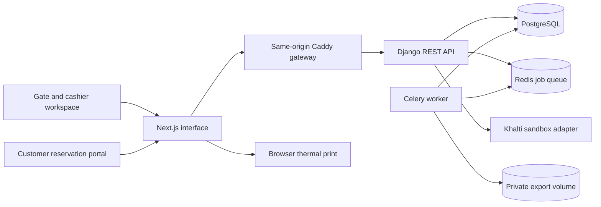

# Bayline — Parking Operations

> Project 2 of 9: independent recreation of the SaaS Parking Platform.
> Portfolio mapping: SaaS Parking Platform (`parking-platform`). Blueprint numbering is build order, not the original portfolio index.
> Version 1.0 — 8 September 2026. Implementation specification; application not yet built.
> This file is a standalone handoff. No other blueprint or previous conversation is required.

## 1. Start, scope and success

Create a new repository at `<projects-root>/portfolio-recreations/parking-platform/`. On the original machine the projects root is `C:/Users/khatr/OneDrive - Prime College/Desktop/Project`; on another machine use the user's actual workspace. Inspect an existing destination before resuming it. Preserve existing parking repositories, databases, credentials and portfolio content. Copy this file into the new application's `docs/BLUEPRINT.md` and maintain `docs/PROGRESS.md`.

Build a responsive working parking product for operators, cashiers, managers and customers. Use fictional **North Gate Parking** and **Riverside Parking** organisations to demonstrate isolation. Core workflows must persist in a real local database; illustrative data must not substitute for implementation.

Included: organisations, locations, bays, vehicle types, tariffs, reservations, gate entry/exit, memberships, cash and simulated QR payment, optional Khalti sandbox checkout, receipts, thermal print layouts, shifts, collection reconciliation, audited void/refund workflows and PDF/XLSX exports.

Excluded: physical barriers, automatic plate recognition, Flutter, production money movement, commercial subscription billing, guaranteed offline checkout and statutory tax-compliance certification. Public discovery uses seeded coordinates and an accessible schematic location map; no paid geocoding dependency. Staff navigation is English; accept and display Devanagari plates/names without corruption.

Success journey: open a shift -> admit a vehicle -> display occupancy -> calculate a reproducible charge -> settle it -> record physical exit -> print a receipt -> reconcile the shift. Also demonstrate a reservation, a member visit, a duplicate callback, a void and a refund without corrupting totals.

## 2. Architecture and technology

Use a transaction-centred Django modular application with separate read/report queries and asynchronous exports. PostgreSQL owns occupancy, capacity, fees and payment truth. Redis caches nothing whose loss could change money or capacity.



| Layer | Choice |
|---|---|
| Frontend | Node 22.12+ LTS, pnpm 10, Next.js 16, React 19, TypeScript |
| UI | Tailwind 4, Base UI, Lucide, TanStack Query/Table, React Hook Form/Zod |
| Backend | Python 3.12, uv lockfile, Django 5.2 LTS, DRF, drf-spectacular |
| Persistence | PostgreSQL 17; database-backed Django sessions |
| Jobs | Celery/Redis 7 for exports and payment reconciliation |
| Documents | ReportLab for PDF, openpyxl for XLSX; embedded licensed fonts |
| Runtime | Docker Compose, Caddy, private local file volume |
| Testing | pytest/pytest-django, Vitest/Testing Library, Playwright/axe |

Pin compatible patched dependencies during setup. Read installed Next.js docs before framework-specific code. Use Django migrations, never schema synchronization against an inherited database. All payment arithmetic uses integer paisa; tax rates use integer basis points. Never use binary floating point for fees.

Repository: `apps/web`, `backend/config`, `backend/modules/{identity,locations,tariffs,reservations,parking,memberships,payments,shifts,reports,audit}`, `contracts`, `fixtures`, `infra`, `tests`, `docs`. Python modules interact through services; frontend types are generated from OpenAPI. Next.js renders shells and interactive screens; business writes go through DRF. Private responses are not placed in a public render cache.

This edition has one API deployment, one worker and one PostgreSQL instance. Poll occupancy every five seconds while visible; refetch after writes and on focus. Responses include `asOf`. Server validation handles stale screens; no websocket service is required for correctness.

## 3. Data model and access

All records use UUIDs, UTC timestamps and organisation scope. Locations use `Asia/Kathmandu` by default. Mutable configuration has `revision`; financial and historical records are append-only after confirmation.

| Entity | Fields / invariant |
|---|---|
| Organisation | name, timezone, currency fixed `NPR`, enabled |
| User/Membership | email/password hash; organisation, role, allowed locations, enabled |
| StaffActionToken | hashed invitation/recovery token, purpose, expiry, consumed time |
| Location | organisation, name, address, coordinates, receipt prefix, enabled |
| Bay | location, label, vehicle class, mode `WALK_IN/RESERVABLE`, operational state |
| TariffVersion | location/class, immutable block/grace/rate/cap/tax settings, effective time |
| Customer | organisation, name/contact, account identity; synthetic in demo |
| Vehicle | organisation, display plate, normalized plate, vehicle class |
| Reservation | customer, vehicle, bay, start/end, status, expiry, confirmation code hash |
| ParkingSession | location, bay, vehicle, entry/exit times, pinned tariff, reservation/member entitlement, status |
| CheckoutInvoice | purpose PARKING/MEMBERSHIP, optional session/pass-purchase reference, cutoff time, immutable fee lines, tax, total, reference, state |
| PaymentAttempt | invoice, method, provider mode, local order ID, pidx, amount, status, lookup lease |
| PaymentEntry | attempt, optional applied invoice, intended invoice for exceptions, signed paisa amount, kind `CAPTURE/REFUND`, method, timestamp, shift |
| RefundRequest | original capture, amount, reason, requested/approved/settled status |
| VoidRecord | session/invoice, reason, actor, time; never replaces a refund |
| MemberPass | customer, permitted plates/locations, start/end, entitlement snapshot, status |
| Shift | location/operator, opened/closed time, opening float, counted cash, expected cash, variance |
| Receipt/PrintEvent | immutable invoice/payment reference; print actor/time/copy count |
| IdempotencyRecord | actor/operation/key unique, payload hash, safe response, expiry |
| ExportJob | scope, filters, asOf snapshot, status, storage key, expiry |
| AuditEvent | organisation, actor, action, entity, safe change summary, correlation ID |

Use composite constraints or explicit constraint triggers where needed to reject cross-organisation foreign-key combinations, including payments and exports. Scope querysets before pagination/aggregation. A guessed other-organisation ID returns `404`; disallowed action within the user's organisation returns `403`.

Roles: OWNER manages staff, locations and all operations; MANAGER manages tariffs, passes, approvals and reports; OPERATOR admits/exits vehicles only at assigned locations; CASHIER settles payments and opens/closes own shifts; AUDITOR reads scoped reports/history. A staff member may hold operator+cashier capabilities through an explicit role combination; do not grant ownership to achieve both. Protect the last enabled owner.

Use Django session authentication with HttpOnly/SameSite cookies, CSRF and exact origin checks. Owner onboarding creates organisation+membership atomically. Demo staff/customer activation uses expiring one-use links and a local outbox; no unsolicited SMS/email. Ordinary CI mocks communication and payment providers. Customer routes expose only their own reservations/receipts; customer contact data never appears on a public occupancy screen.

## 4. Occupancy, reservations and gate rules

### Capacity and concurrent entry

Bay rows are the locking unit. A PostgreSQL partial unique constraint allows at most one non-exited/non-voided ParkingSession per bay. Also forbid simultaneous open sessions for the same normalized plate within an organisation. Normalize Unicode to NFC, trim/collapse whitespace and uppercase Latin letters; preserve Devanagari and meaningful punctuation. Show the original display plate.

Entry service locks the bay, verifies location permission, vehicle compatibility, operating state and absence of active occupant, then creates the session and pins tariff/member entitlement in one transaction. Return `409 BAY_UNAVAILABLE` on conflict. Never update an occupancy counter separately from the session transaction.

When applying a member pass, acquire the pass row lock before bay locks and enforce its simultaneous-vehicle limit under that lock. Every pass activation, entry, exit and correction that changes this entitlement count uses the same pass-then-sorted-bay lock order. Pin the latest applicable tariff effective at server entry time, with a unique location/class/effective-time constraint; no browser-selected historic rate.

Reservations use only RESERVABLE bays; walk-ins use WALK_IN bays. This explicit separation prevents a walk-in with unknown duration from silently consuming future reserved capacity. A manager may change a bay's mode only when no current occupant or future reservation exists.

Before any reservation insert/update under the bay lock, transition elapsed HOLD rows to EXPIRED. The exclusion constraint uses stored blocking states, not a time-dependent index predicate; this synchronous cleanup prevents a delayed worker from leaving a stale hold that blocks a valid insert.

Reservation lifecycle is `HOLD -> CONFIRMED -> CHECKED_IN -> COMPLETED`, with `EXPIRED`, `CANCELLED` and `NO_SHOW` terminal alternatives. Blocking reservation states are HOLD, CONFIRMED and CHECKED_IN; COMPLETED follows physical exit. Reservation intervals are `[start,end)` and cannot overlap for the same bay in those blocking states. Create/modify/cancel reservations while locking that bay; use a PostgreSQL exclusion constraint as the final guard. Require start in the future, minimum 30 minutes, maximum 12 hours. A requested reservation holds capacity for five minutes while the customer confirms; this edition does not collect a reservation deposit. Confirmation atomically turns HOLD into CONFIRMED. Expired holds are ignored by availability queries even if cleanup is late.

Customer cancellation is allowed before check-in. Check-in is permitted from ten minutes before start until fifteen minutes after start, only if the bay is actually free. After that arrival window, a worker marks NO_SHOW and releases future claim. Revalidate against database time, not the browser timer.

Early arrival also requires that no other blocking reservation claims the bay between actual entry and this reservation's start. Enforce that check under the bay lock; physical vacancy alone does not override another customer's interval. Apply arrival-window expiry synchronously during availability/entry mutations when the no-show worker is late.

An overstaying reserved vehicle remains the actual occupant. Flag the next reservation as an operational conflict; never pretend the bay is free. Manager may relocate the next reservation to a free compatible reservable bay with no overlapping interval, locking both bays in UUID order, or cancel it with a reason. The demo does not promise physical vacancy that software cannot enforce.

### Session and invoice lifecycle

Session states: `PARKED -> CHECKOUT_PENDING -> EXIT_READY -> EXITED`, plus `VOIDED` for an erroneous entry with no capture. A membership-covered visit still follows the state machine and records a zero-due invoice.

Requesting checkout calculates a quote from server time. Quote validity is two minutes and includes tariff version, billing cutoff and total. Confirming it creates a single immutable invoice and moves the session to CHECKOUT_PENDING. Its fee cutoff is frozen during payment; occupancy remains taken until the operator records actual exit. A delay is visible as checkout duration, not an undisclosed extra charge.

After full verified settlement, EXIT_READY allows explicit physical exit. Cash payment and exit may be combined by a staff member with both permissions in one transaction. A provider callback can mark paid but cannot assert that a physical vehicle left.

### Tariff specification and examples

Default synthetic car tariff: five free minutes, then NPR 50 per started 30-minute block. Motorbike: five free minutes, then NPR 20 per started 30-minute block. No daily cap by default. These are demo pricing choices, not market or tax advice.

Billable seconds = max(0, cutoff-entry-grace). Blocks = integer ceiling of billable seconds/block seconds. Gross base charge = blocks × block paisa. Optional daily cap applies per rolling 24-hour segment of billable duration; calculate each segment separately. Tariff versions freeze the chosen cap behavior.

Tax is an optional configurable demo rate, default zero. Calculate tax once from invoice base using Decimal half-up rounding to paisa. Do not describe a receipt as an approved fiscal invoice or claim current statutory compliance. Discounts are fixed authorised paisa adjustments capped at the base and include actor/reason; no operator-entered arbitrary total.

Example: a car at 09:00 with cutoff 09:35 has 30 billable minutes, one block, NPR 50. At 09:35:01 it has two blocks, NPR 100. A five-minute stay is zero. Tests cover exact boundaries, midnight, caps and tax rounding.

Membership plans cover eligible visits whose entry lies within the pass interval, up to 24 hours per visit; excess duration uses the entry-pinned tariff. Limit one active vehicle per pass unless its snapshotted entitlement explicitly allows more. Membership sale payments use distinct invoice purpose `MEMBERSHIP`; do not mix them invisibly into parking collections.

For a covered visit, chargeable excess starts exactly at entry plus 24 hours, with no second free grace allowance; use the same block/cap/tax rules on that excess. A PARKING invoice requires exactly one session and no pass-purchase reference; a MEMBERSHIP invoice requires a pass-purchase reference and no session. Add database checks for these combinations. Purchase/renewal stores immutable price and proposed validity terms; activate the pass only after full verified settlement (or an explicitly authorised zero-price plan), never merely after invoice creation. Renewal starts at the later of the old expiry or the snapshotted proposed start and does not retroactively alter already pinned visits.

## 5. Payments, corrections and financial reports

### Settlement authority

Cash confirmation creates one positive PaymentEntry and updates invoice balance transactionally. Operator-entered QR is `QR_SIMULATED` and visibly labelled. Khalti integration runs in sandbox only; fixture mode supplies deterministic success/pending/cancel/duplicate scenarios.

Server initiates a Khalti payment using its own invoice amount/order ID, stores pidx, and returns the supplied checkout URL after origin validation against the provider's allowed checkout hosts. Return/callback query parameters are hints, not settlement proof. The server performs lookup and validates identifier, amount and completion status before capture. Never accept a browser-supplied amount or status. This follows the provider's initiation/lookup flow; see [Khalti web checkout](https://docs.khalti.com/khalti-epayment/).

Persist the attempt before calling the provider; do not hold database locks across network calls. One unresolved attempt per invoice. Use a state machine `CREATED/INITIATING/PENDING/SUCCEEDED/FAILED/UNKNOWN`. An initiation timeout is UNKNOWN and prevents blind retries that might create a second payment. The operator must reconcile the recorded order in the sandbox dashboard/lookup or mark it confirmed-not-created with evidence before a new attempt. Missing pidx after a lost response is a surfaced manual-reconciliation case, not an invented success.

Capture uniqueness uses provider transaction identity and attempt ID. Repeated/late callbacks have one financial effect. A periodic lookup worker revisits known pending pidx values. If a duplicate provider payment genuinely occurs, record the extra unapplied capture as an exception and refund it through an explicit workflow; do not hide actual funds or apply the invoice twice.

### Voids and refunds

Void is permitted only for an incorrect entry/invoice with no captured funds, requires manager approval/reason and keeps history. Voiding a pending external attempt is blocked until its outcome is resolved. A paid transaction requires a refund record, never deleting its payment.

Refunds append negative entries linked to the original capture; cumulative refunds cannot exceed it. Cash refunds require a manager and an open cash shift. Provider refunds in this edition use a simulated adapter and are labelled as such; no claim of live settlement. Voiding, refunding and physical occupancy are separate: refunding an exited visit does not reopen a bay/session.

### Shift and report definitions

Open shift records opening cash float. Cash captures/refunds reference the accepting operator's open shift. An operator cannot close a shift concurrently with an unsettled local cash mutation: lock the shift on both operations. Expected cash = opening float + cash captures - cash refunds. Counted cash is entered separately; variance is counted minus expected. Closing records an immutable summary. Corrections after close create explicit adjustment entries in a new shift, never rewrite the closed one.

| Report | Definition |
|---|---|
| Current occupancy | PARKED, CHECKOUT_PENDING and EXIT_READY sessions; never payments alone |
| Parking billed | Confirmed parking invoices by cutoff/business date; exclude voided, show unpaid separately |
| Collections | Captures minus refunds by their actual posted time, method and location |
| Cash shift | Shift-assigned cash movements plus opening float; includes variance |
| Membership sales | MEMBERSHIP invoice collections shown separately |
| Vehicle log | Entry/exit chronology including voided records and reasons |
| Exceptions | Unknown provider outcomes, unapplied captures, pending exits and overstay conflicts |

Local date filters convert to UTC half-open ranges using location timezone. Keep refund date distinct from original sale date. Totals come from immutable entries, not mutable session display amounts. PDF/XLSX exports use the same scoped query/service as the screen, with filter summary and asOf timestamp. For a repeatable export, snapshot selected record IDs/values in the job transaction. Escape spreadsheet formula-leading text; never export another location just because a background job runs as a service account.

## 6. API and failure contracts

REST `/api/v1`; JSON camelCase with amounts as integer paisa, UUID strings and ISO UTC dates. Generate OpenAPI through drf-spectacular. Lists use cursor pagination, default 25/max 100. Mutations use explicit `expectedRevision` where mutable; `Idempotency-Key` is mandatory for entry, reservation confirmation, invoice confirmation, cash capture, refund and exit. Bind key to actor/operation/payload; retain replay metadata seven days for operational writes and preserve financial uniqueness indefinitely.

| Endpoints | Core behavior |
|---|---|
| `/auth/register`, `/login`, `/logout`, `/session`; `/members` | Organisation/session and role management |
| `/locations`, `/locations/:id/bays`, `/tariffs` | Scoped setup; publish immutable tariff versions |
| `/public/locations`, `/public/locations/:id/availability` | Safe discovery/capacity; no plates/customer details |
| `/customer/reservations`; `/reservations/:id/confirm`, `/cancel`, `/relocate` | Own booking or staff-authorised management |
| `/parking/entries`, `/parking/sessions`, `/parking/sessions/:id` | Transactional entry and active/history queries |
| `/parking/sessions/:id/quote`, `/checkout`, `/exit`, `/void` | Fee preview, invoice creation and explicit lifecycle transitions |
| `/invoices/:id/payments`, `/payments/:id/reconcile` | Cash/fixture/sandbox initiation; server-side verification |
| `/payments/khalti/return` | Public provider return handler that schedules verification, not trust-based capture |
| `/refunds`, `/refunds/:id/approve` | Controlled append-only correction |
| `/memberships`, `/memberships/:id/renew` | Versioned pass entitlement and renewal invoice |
| `/shifts/open`, `/shifts/:id/summary`, `/shifts/:id/close` | Cash accountability |
| `/reports/collections`, `/reports/vehicle-log`, `/reports/exceptions` | Same scope/calculation as exports |
| `/exports`, `/exports/:id`, `/exports/:id/download` | Job creation, status and authorised download |
| `/receipts/:id`, `/receipts/:id/print-events` | Immutable receipt and logged print attempt |
| `/health/live`, `/health/ready` | Local process/dependency checks |

Success: `{ "data": ... }`. Error: `{ "error": { "code": "BAY_UNAVAILABLE", "message": "The selected bay is occupied.", "fieldErrors": {}, "retryable": false }, "requestId": "..." }`. Conflict is 409, missing precondition 428, permission denial 403/404, rate limit 429. No successful HTTP status for a failed payment.

```json
{
  "locationId": "<uuid>",
  "bayId": "<uuid>",
  "plate": "BA 12 PA 3456",
  "vehicleClass": "CAR",
  "reservationId": null
}
```

Provider/public endpoint inputs are bounded and validated. Staff write endpoints require session/CSRF; customer mutations require customer authentication. Invitation/recovery links expire and consume once. Payment credentials never enter frontend bundles or logs.

Database outage disables writes; the UI labels last-known occupancy with its timestamp. Offline entry/payment is not queued for later because replay could oversell or double-charge. Print failure never rolls back an already settled payment; retry prints the same numbered receipt marked copy. Browser print-dialog completion is not proof a physical printer printed; audit records requested/reprinted, not guaranteed printed.

Worker retries exports by job ID and payment lookups by attempt ID. Recheck scope on every job/download. Export links expire in 24 hours. Structured logs include correlation, session/invoice/attempt IDs but redact contact details and keys. Track conflicts, unknown payments, reconciliation age, export failures and shift variance; no fabricated uptime or user counts.

## 7. Professional design system

### Direction and tokens

Bayline is a bright, fast operational workspace. The defining visual is a labelled occupancy grid linked to a compact vehicle drawer. Financial screens emphasize alignment and numerical clarity. The public reservation flow uses the same identity with more spacing and simpler navigation.

| Token | Value / rule |
|---|---|
| Canvas / surface / inset | `#F5F3EE` / `#FFFFFF` / `#EAEFEA` |
| Primary / secondary text | `#172B2B` / `#4B6262` |
| Brand / on-brand | `#00645C` / `#FFFFFF` |
| Available / occupied | `#00645C` / `#385B94`, always with icon/label |
| Warning / error | `#805600` / `#A62B34`; pale tinted backgrounds with dark text |
| Control border / focus | `#718681` / `#00645C` with 2px ring and 2px offset |
| Typeface | IBM Plex Sans; IBM Plex Mono for short IDs; Noto Sans Devanagari fallback |
| Type scale | 12 metadata, 14 dense table, 16 controls/body, 20 section, 28 page, 40 occupancy count |
| Spacing | 4/8/12/16/24/32/48 px |
| Geometry | 6px controls, 10px panels; avoid pill-shaped tables/cards |
| Motion | 120ms feedback, 180ms drawer; no moving occupancy tiles during checkout |

Tabular numerals for all money/time. Never rely on red/green alone. Each bay shows identifier, state word, class icon and optional duration. Focus/hover does not alter tile dimensions. Verify rendered AA contrast, including semantic backgrounds; listed palette is a design choice, not a completed accessibility audit.

Desktop shell: 224px navigation, 64px top bar with persistent organisation/location/shift selector, flexible workspace and optional 360px vehicle drawer. Show which location a mutation affects inside its confirmation, not just in a distant header. Large location changes close stale drawers or require reload of entity context.

### Screen specifications

| Route | Composition and main action |
|---|---|
| `/operations` | Occupancy strip + searchable bay grid/list + quick entry; current shift visible |
| `/operations/entry` | Plate field focused, class, compatible bay, member/reservation match, confirm entry |
| `/operations/sessions/:id` | Entry facts, pinned tariff, duration, quote and payment/exit state |
| `/operations/checkout/:id` | Left vehicle/time evidence; right fixed fee breakdown and method selection; explicit confirm |
| `/reservations` | Date/location filters, customer/plate, arrival window, conflict and relocation tools |
| `/members` | Pass/plate search, entitlement interval and renew action |
| `/shifts` | Open/active/closed shift views; cash count form and variance explanation |
| `/reports` | Collection table and totals, filters, comparison by method, export job status |
| `/exceptions` | Unknown payment, overstay, unapplied capture and delayed exit queues |
| `/settings` | Locations/bays, tariffs, staff, receipt identity and sandbox readiness |
| `/park` | Location list/map, time/class availability and account entry |
| `/park/reserve` | Time -> allocated bay summary -> customer/plate -> confirmation |
| `/account/reservations/:id` | QR/reference, arrival window, cancellation and own receipt |

At widths below 768px use four operational tabs: Entry, Find vehicle, Reservations, Shift. Present maps/grids as compact rows; show totals before payment options. At 768–1199px use a navigation rail and sheet details; at 1200+ allow grid+drawer. All page widths fit 360px and 200% zoom. Touch actions at least 44px; form inputs 44–48px. Keyboard plate search uses a visible shortcut hint and never captures keys while typing elsewhere.

Components: BayTile, VehicleRow, TariffBreakdown, PaymentMethodPicker, ProviderStatusPanel, ReceiptPreview, ShiftCountForm, ConflictNotice, TimeRangeField, StatusBadge and AuditTimeline. Each has loading/empty/error/pending/disabled states. Disable repeated payment submissions with pending status but retain server idempotency. Keep unknown payments visibly unresolved with a reconciliation action.

Receipt layout supports 58mm and 80mm widths with monochrome print styles, no clipped columns, labelled copy number and QR pointing only to an authorised receipt route. Staff/customer private data does not become public through a QR link. Browser screenshots use the preview, not a claim of tested physical printing.

Use local synthetic parking-plan artwork and schematic pins; avoid paid maps. Self-host fonts and licence notices. Motion is reduced to immediate state changes under reduced-motion preference. Complete keyboard flows, field error summaries, focus restoration and screen-reader labels; auto-refresh must not steal focus or announce every bay repeatedly.

## 8. Setup, seed and delivery sequence

Default gateway `http://localhost:4330`; web/API/PostgreSQL/Redis stay behind it. Bind loopback only. Provide full Compose and native-development profiles with explicitly different database hostnames. Server secrets generated by setup and ignored by Git; `PAYMENT_MODE=fixture` is default. `khalti_sandbox` requires an explicit sandbox base URL/key and never silently falls back to fixture. Production Khalti host is refused by the demo adapter.

Environment: APP_ORIGIN, DJANGO_SECRET_KEY, DATABASE_URL, TEST_DATABASE_URL, REDIS_URL, PRIVATE_STORAGE_ROOT, PAYMENT_MODE, KHALTI_SANDBOX_KEY, KHALTI_SANDBOX_BASE_URL, LOCATION_TIMEZONE. No keys in settings UI. uv/pnpm locks and Docker images are pinned to compatible patches; no dependency on the original repositories.

Required root command surface: `pnpm setup:local`, `pnpm demo:up`, `pnpm dev`, `pnpm db:migrate`, `pnpm db:seed`, `pnpm demo:reset`, `pnpm contracts:generate`, `pnpm contracts:check`, `pnpm lint`, `pnpm typecheck`, `pnpm build`, `pnpm test:unit`, `pnpm test:integration`, `pnpm test:e2e`, `pnpm screenshots`. Wrapper scripts call uv/Django where needed. Reset verifies the demo database marker/name/host and resolved media path before deletion. Never point tests at an inherited DATABASE_URL.

Seed two organisations, two locations in the first, 12 walk-in and 6 reservable bays, car/bike tariffs, owner/manager/operator/cashier/auditor, 20 synthetic sessions covering all states, confirmed/no-show reservations, two passes and open/closed shifts. Include a real arithmetic fixture: opening cash NPR 1,000 + captures NPR 350 - refund NPR 50 = expected NPR 1,300; counted NPR 1,280 yields variance NPR -20. Generate these through domain services, not inconsistent direct table inserts. Fixture clock controls test dates, interactive mode uses actual time.

| Milestone | Work and exit evidence |
|---|---|
| M0 Foundation | New workspace, services, scopes, authentication, tokens/UI gallery; clean setup/build |
| M1 Bay and tariff core | Locations, bay locks, tariff versions/calculator; concurrent-entry and boundary tests |
| M2 Gate journey | Session lifecycle, quote/invoice, memberships; complete entry-to-zero/cash checkout |
| M3 Reservations | Customer account, holds, overlap constraints, arrivals/relocation; race and overstay tests |
| M4 Payment integrity | Cash/QR fixtures, Khalti sandbox adapter, capture/refund/void rules; duplicate/unknown outcomes tested |
| M5 Shift/reporting | Append-only collections, close/variance, receipts and exports; screen/export totals agree |
| M6 Product polish | Responsive screens, keyboard flows, failure recovery and print previews; manual visual review |
| M7 Evidence | Fresh setup, isolated tests, screenshots, demo, API/runbooks and actual sandbox evidence |

If sandbox credentials are unavailable, continue fixture work but label sandbox validation pending. Do not mark a real integration complete solely because its adapter compiles.

## 9. Acceptance tests and operational evidence

Use real isolated PostgreSQL for transaction tests; SQLite cannot establish lock/exclusion behavior. Mock external providers in CI. Test thread/process concurrency with separate database connections rather than sequential calls pretending to race.

| ID | Required scenario |
|---|---|
| P01 | Other-organisation/location IDs denied in CRUD, receipts, exports, jobs and aggregates |
| P02 | Two simultaneous admissions to one bay produce one occupant |
| P03 | Same plate cannot have two open sessions in the organisation |
| P04 | Grace/block/cap/midnight/tax/discount boundaries produce exact paisa |
| P05 | Changing tariffs cannot change an existing pinned session/invoice |
| P06 | Duplicate checkout/cash request returns the same financial effect |
| P07 | Holds expire correctly without waiting for a worker; reservations cannot overlap |
| P08 | Overstay never creates a second physical occupant; relocation rechecks both bays |
| P09 | Membership eligibility/cap/concurrent pass usage is correct |
| P10 | Forged callback, amount mismatch or unrelated pidx cannot settle an invoice |
| P11 | Timeout/unknown initiation cannot silently launch another charge |
| P12 | Duplicate and late verified callbacks create one capture; actual excess is an exception |
| P13 | Void is blocked for captured/unresolved payments; refunds cannot exceed original capture |
| P14 | Payment success does not assert physical exit; exit releases capacity once |
| P15 | Closing shift races safely with cash capture/refund |
| P16 | Collection/refund-date/membership reports match exported snapshots and seeded totals |
| P17 | Browser print failure/reprint does not duplicate payment/receipt number |
| P18 | Provider outage/offline UI preserves truth and prevents queued blind mutations |
| P19 | Revoked staff/customer access invalidates private downloads and mutations |
| P20 | Formula-like names in XLSX remain text; filters remain organisation-scoped |
| P21 | 360px, 768px, desktop, 200% zoom, keyboard, Devanagari and monochrome receipts pass |
| P22 | Clean setup and guarded reset/backup restore only affect dedicated demo storage |

Measure gate-entry task duration and checkout errors with realistic fixtures; do not invent throughput or revenue claims. Require no unexplained monetary difference in the fixed reconciliation suite. Latency goals: local occupancy query p95 below 500ms with 10,000 seeded sessions; report actual hardware/data/results rather than claim these as existing performance.

## 10. Screenshots and independent handoff

Capture: populated occupancy grid/drawer, fee breakdown and payment status, 80mm receipt preview, reservation conflict/relocation, shift variance/report and mobile gate entry. Save PNG originals and WebP delivery copies with alt text and captions in `artifacts/screenshots`. Keep fixture/sandbox badges visible. No screenshot should contain real plates or contact data.

Five-minute demo: open shift -> entry -> reserve another bay -> checkout/pay/exit -> inspect duplicate payment handling -> refund sample -> close and reconcile -> download matching report. Include a second-organisation access denial in the technical walkthrough.

Application handoff files: README, docs/BLUEPRINT.md, docs/PROGRESS.md, docs/DECISIONS.md, docs/API.md, docs/OPERATIONS.md, docs/EVALUATION.md, docs/DEMO.md, docs/CASE_STUDY.md, environment template, locked dependencies, migrations, seeds and CI. Record actual test commands/results and any sandbox/physical-printer limitations. Describe this as an independent portfolio edition; old employer commit counts are not evidence for the new repository.

Primary references: [Django transaction locking](https://docs.djangoproject.com/en/5.2/ref/models/querysets/#select-for-update), [PostgreSQL range exclusion constraints](https://www.postgresql.org/docs/17/rangetypes.html#RANGETYPES-CONSTRAINT), [Khalti sandbox initiation and lookup](https://docs.khalti.com/khalti-epayment/). Recheck patched package/provider APIs during implementation; references do not authorize real payments.

### Copy-ready new-task prompt

> Implement Bayline using this standalone blueprint in a new `<projects-root>/portfolio-recreations/parking-platform` repository. Inspect existing destination state/instructions first and preserve all original projects. Read installed framework documentation. Build the milestones in order with actual local persistence, transaction/organisation constraints, exact paisa arithmetic and the specified bright operational design system. Use synthetic data and fixture payments; integrate only Khalti sandbox when credentials are supplied. Keep unknown outcomes visible, verify concurrency with real local PostgreSQL and do not claim physical printing or live financial integration without evidence. Maintain docs/PROGRESS.md, complete the acceptance matrix and deliver reproducible setup, screenshots and a walkthrough. Do not modify the portfolio or publish/deploy externally as part of this handoff.
