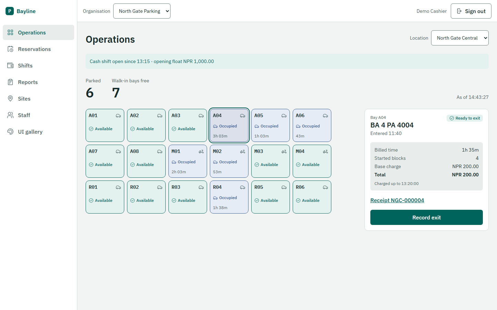

# Bayline — Parking Operations

A multi-tenant parking operations app for car parks that take cash at the gate. Staff
admit vehicles to bays, quote and take payment, print receipts, close cash shifts
against counted cash and export collections reports. Customers can find a free bay,
hold it and book it.

Django and PostgreSQL on the back end, a Vite and React single-page app on the front,
behind one Caddy gateway. North Gate Parking and Riverside Parking are fictional
organisations, and all data is synthetic.



*The gate screen from the seeded demo, signed in as the demo cashier, captured on
8 November 2026.*

## Try it

Needs Docker with Compose, Node 24+, pnpm 10, Python 3.12 and [uv](https://docs.astral.sh/uv/).

```sh
pnpm setup:local && pnpm db:seed && pnpm demo:up
```

Open http://localhost:4330 and sign in as `cashier@northgate.test` with the
`DEMO_PASSWORD` that `setup:local` wrote to the gitignored `.env`. Choose
**North Gate Central** as the location. To stop it, run `docker compose --env-file .env -f infra/compose.yaml down`.

- `setup:local` creates `.env` with generated secrets, installs dependencies, starts
  PostgreSQL on `127.0.0.1:54330` and applies migrations.
- `db:seed` adds the demo data through the domain services, and rerunning it changes
  nothing. That data is two organisations, three locations with tariffs, staff in
  every role (`owner@`, `manager@`, `operator@`, `cashier@` and `auditor@northgate.test`,
  plus `owner@riverside.test`), two customers (`asha@` and `bina@customer.test`),
  a closed and an open cash shift, and reservations that include an overstay conflict
  and a no-show.
- `demo:up` builds and starts the containerised stack: the API, a background worker
  and the gateway.

Last run from a fresh clone on 8 November 2026 (Windows 11, Docker Desktop): setup,
seed and the stack all came up, and the seeded gate showed 6 parked vehicles and 7
free walk-in bays.

What to try:

- **Gate** (`/operations`): admit a vehicle, quote and confirm checkout, take cash,
  then record the exit.
- **Receipts**: each payment links to a receipt that prints on 80 or 58 mm paper.
- **Shifts and reports** (`/shifts`, `/reports`): close a shift against counted cash,
  and download collections and the vehicle log as PDF or XLSX. Reports need an owner,
  manager or auditor account.
- **Reservations** (`/reservations`): each day's bookings with overstay conflicts.
- **Customers** (`/park`, `/account/reservations`): find free bays, hold one and
  confirm it.

For host development without containers (`pnpm dev`, Vite on the same port proxying
to Django on `127.0.0.1:8330`), see [development](docs/DEVELOPMENT.md).

## Tests and CI

| Suite | Size | Runs against |
| --- | --- | --- |
| Backend (pytest) | 610 tests in 56 files | A dedicated PostgreSQL test database, including concurrency tests |
| Web (Vitest) | 13 files | jsdom |
| Tariff vectors | Shared JSON fixtures | Run by both pytest and Vitest, so both sides compute the same fee |

CI ([`.github/workflows/ci.yml`](.github/workflows/ci.yml)) runs setup, lint,
typecheck, unit and integration tests, the production build and a check that the
committed OpenAPI contract matches the code. It runs on every pull request and every
push to `main`. **The last run on `main` passed, on 15 September 2026.**

## Engineering decisions

**Payment and exit are separate requests, so a retry cannot take cash twice.** Each
gate action carries its own idempotency key and makes one change. If the network
drops after the cash is captured, the client retries only the exit. The checkout
quote is signed on the server with its cutoff time, and checkout recalculates the fee
from the pinned tariff, so the browser never supplies an amount.
([D29, D31](docs/DECISIONS.md))

**Receipt numbers have no gaps.** Each location's counter row is upserted
(`INSERT … ON CONFLICT DO UPDATE … RETURNING`) inside the cash capture transaction,
last in the lock order. A capture that rolls back also rolls back its number, and a
reprint records a numbered copy without issuing a new number. ([D33](docs/DECISIONS.md))

**Two customers cannot book the same bay.** A hold locks the bay, clears lapsed holds
and missed arrivals, rechecks and inserts. A PostgreSQL exclusion constraint on
overlapping blocking reservations is the final guard. Each account may keep at most
two unconfirmed holds, so a script cannot hold every bay without paying.
([D42, D44](docs/DECISIONS.md))

Money is stored as integer paisa throughout.

## Known limits

- **Cash only.** Online payments, refunds and voids (milestone M6) are not built, so
  there is no payment gateway integration.
- **Built through milestone M4 of eight.** `main` has the foundation, sites and
  tariffs, the cash gate journey, shifts, receipts, reports and reservations. Member
  passes, offline devices and printer integration are planned in the
  [specification](docs/BLUEPRINT.md) but are not on `main`.
- **Printing is browser print CSS.** Receipts were laid out for 58 and 80 mm paper but
  not tested on a physical printer.
- **Local only.** There is no production deployment.

## Documentation

- [Development](docs/DEVELOPMENT.md): host setup, the worker and every check command
- [Specification](docs/BLUEPRINT.md) (v1.1; the original v1.0 is `02-parking-platform.md`)
- [Decisions](docs/DECISIONS.md) and [build log](docs/PROGRESS.md)

## License

No license has been chosen yet, so all rights are reserved.
