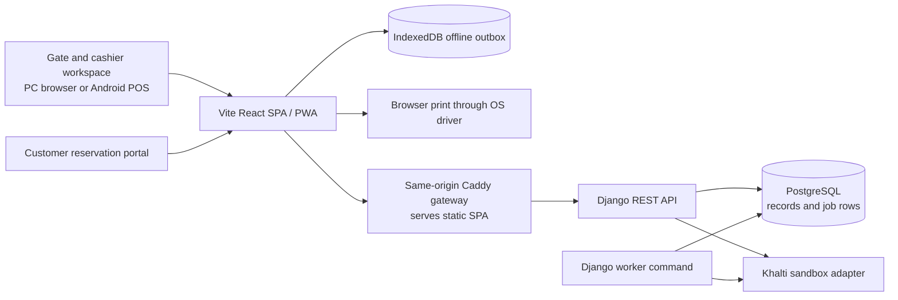

# Bayline — Parking Operations

> Project 2 of 9: independent recreation of the SaaS Parking Platform.
> Portfolio mapping: SaaS Parking Platform (`parking-platform`). Blueprint numbering is build order, not the original portfolio index.
> Version 1.1 — 13 September 2026. Revises v1.0 (8 September 2026), kept unchanged at the repository root as `02-parking-platform.md`. Build in progress; see `docs/PROGRESS.md`.
> This file is a standalone handoff. No other blueprint or previous conversation is required.

## Client direction update — 29 October 2026

The client is PWA only: no Flutter or Capacitor/native Android shell. The installable static app and offline screen are implemented; IndexedDB transaction outbox, registered-device sync and offline cash capture remain planned. See `docs/PWA.md` for the current delivery boundary and verification. Earlier milestone descriptions below are specifications, not claims that all features are built. Browser printing requires OS/browser-compatible hardware; vendor SDK-only POS printers are outside this delivery.

## Domain update — 1 November 2026

Staff-created customer profiles can exist without an online User (D58); matching contacts never claim accounts. Locations now support assigned bays and open-lot zones with vehicle-class pools (D59). Sessions always reference a zone and exactly one bay or pool. The API keeps `bayLabel` as a space label while allowing nullable `bayId`. Reservations remain assigned-bay only. See `CUSTOMER_PROFILES.md` and `OPEN_LOT_CAPACITY.md` for the delivered model, lock order, migration and UI boundaries; these supersede mandatory account/bay assumptions in the original specification below. Offline writes remain planned.

## 0. Revision 1.1 summary

| Area | v1.0 | v1.1 | Reason |
|---|---|---|---|
| Frontend | Next.js 16 | Vite + React SPA served as static files by Caddy; installable PWA | Private, session-authenticated staff app with no SEO need. Removes the Node runtime and the private-response-in-render-cache risk class; clean base for offline use |
| Jobs | Celery + Redis | `manage.py worker` claiming PostgreSQL rows with `FOR UPDATE SKIP LOCKED` | The job rows already exist (pending attempts, holds). Enqueue joins the business transaction; one fewer service to lose work |
| Exports | Async ExportJob, private volume, expiring links | Streamed synchronous PDF/XLSX from the report query | Demo volumes export in seconds. Add a queue only when a measured export exceeds 10 s |
| Modules | 10 Django apps | 5 apps cut along lock boundaries | The pass→bay lock order no longer spans three modules |
| Session state | `PARKED/CHECKOUT_PENDING/EXIT_READY/EXITED` plus a mutable invoice balance | `PARKED/EXITED/VOIDED`; payment progress derived from the ledger | One source of truth per fact; invoices stay immutable |
| Quote | Storage unspecified | Signed token valid 120 s | No table |
| Khalti lost initiation | UNKNOWN and manual reconciliation | `FAILED (INITIATION_LOST)`, new attempt allowed | Lookup accepts only `pidx`; without a returned payment URL nobody can pay |
| Pending Khalti vs cash | Gate blocked until resolved | Lookup-then-abandon; a late completion becomes an unapplied capture refunded through the workflow | Payment links live 60 minutes; a gate cannot wait |
| Offline | Forbidden | Cash walk-in facts queued on the device and synced idempotently | Unreliable gate connectivity; physical facts cannot oversell |
| Devices | Browser print only | Installable PWA on supported desktop, tablet and Android browsers | One web client; browser-compatible printers and keyboard scanners |
| Identity | Organisation-scoped Customer; `User/Membership` | Global User with per-organisation Customer profile; staff role row renamed `OrgMember` | Cross-operator discovery; removes clash with member passes |
| Tenancy | Implicit | Shared-schema row scoping stated; subdomains and schema-per-tenant out of scope | Subdomains are branding, not isolation |
| Gaps closed | — | Global lock order with retry, idempotency inside the business transaction, cap/tax/discount rules, receipt counters, append-only trigger, composite foreign keys on the money path, `btree_gist`, single clock, explicit CSRF on anonymous auth endpoints | v1.0 ambiguities |
| Milestones | Payments M4, shifts M5 | Cash success journey complete at M3 | End-to-end demo earlier |

## 1. Start, scope and success

Build in the user's workspace repository (on the original machine `C:/Users/khatr/OneDrive - Prime College/Desktop/Project/parking_personal`). Inspect existing state before resuming. Preserve sibling parking repositories, databases, credentials and portfolio content; this edition depends on none of them. Keep this file as `docs/BLUEPRINT.md` and maintain `docs/PROGRESS.md` and `docs/DECISIONS.md`.

Build a responsive working parking product for operators, cashiers, managers and customers. Use fictional **North Gate Parking** and **Riverside Parking** organisations to demonstrate isolation. Core workflows must persist in a real local database; illustrative data must not substitute for implementation.

Included: organisations, locations, bays, vehicle types, tariffs, reservations, gate entry/exit, memberships, cash and simulated QR payment, optional Khalti sandbox checkout, receipts, thermal print layouts, shifts, collection reconciliation, audited void/refund workflows, PDF/XLSX exports, offline cash walk-in capture with idempotent sync, and receipt printing/scanner input on PC browsers and Android POS terminals.

Excluded: physical barriers, automatic plate recognition, Flutter, iOS POS hardware, production money movement, commercial subscription billing, offline reservations/provider payments/refunds/voids/pass entitlement, subdomain or schema-per-tenant routing, and statutory tax-compliance certification. Public discovery uses seeded coordinates and an accessible schematic location map; no paid geocoding dependency. Staff navigation is English; accept and display Devanagari plates/names without corruption.

Success journey: open a shift -> admit a vehicle -> display occupancy -> calculate a reproducible charge -> settle it -> record physical exit -> print a receipt -> reconcile the shift. Also demonstrate a reservation, a member visit, a duplicate callback, an abandoned-then-completed Khalti payment, an offline cash visit that syncs exactly once, a void and a refund without corrupting totals.

## 2. Architecture and technology

Use a transaction-centred Django modular monolith with separate read/report queries. PostgreSQL owns occupancy, capacity, fees, payment truth and background work: jobs are ordinary rows claimed by a worker, so no second store can lose or duplicate them.



| Layer | Choice |
|---|---|
| Frontend | Node 24 LTS, pnpm 10, Vite 8, React 19, React Router 8, TypeScript 5.9 (openapi-typescript requires TypeScript 5) |
| UI | Tailwind 4, Base UI (added with the first dialog/menu), Lucide, TanStack Query/Table, React Hook Form/Zod |
| Offline and devices | vite-plugin-pwa service worker; planned IndexedDB outbox and registered-device sync; browser print and keyboard scanners |
| Backend | Python 3.12, uv lockfile, Django 5.2 LTS, DRF, drf-spectacular, djangorestframework-camel-case |
| Persistence | PostgreSQL 17 with `btree_gist`; database-backed Django sessions; Django `DatabaseCache` for throttling |
| Jobs | `manage.py worker` loop claiming due rows with `FOR UPDATE SKIP LOCKED`; no Redis or Celery |
| Documents | ReportLab for PDF, openpyxl for XLSX, streamed synchronously; embedded licensed fonts |
| Runtime | Docker Compose: Caddy (static SPA and reverse proxy), api, worker (same image), db |
| Quality | Ruff (Python), Biome (TypeScript/CSS/JSON) |
| Testing | pytest/pytest-django, Vitest/Testing Library, Playwright/axe |

Pin compatible patched dependencies during setup. Read the installed Vite, React Router, Tailwind and Vitest documentation before framework-specific code; these move faster than any fixed reference. Use Django migrations, never schema synchronization against an inherited database. All payment arithmetic uses integer paisa; tax rates use integer basis points. Never use binary floating point for fees.

Repository: `apps/web` (the sole client, including PWA assets), `backend/config`, `backend/modules/{accounts,sites,parking,billing,reports}`, `contracts`, `fixtures`, `infra`, `scripts`, `docs`. Module boundaries follow transaction and lock boundaries:

| App | Owns | Why together |
|---|---|---|
| `accounts` | Organisation, User, OrgMember, StaffActionToken, Customer, Device, IdempotencyRecord, AuditEvent | Identity, scope and audit primitives used by every write |
| `sites` | Location, Bay, TariffVersion, ReceiptCounter | Configuration; tariff versions are immutable |
| `parking` | Vehicle, ParkingSession, Reservation, MemberPass, DeviceEvent | Share the pass→bay lock order and occupancy invariants |
| `billing` | CheckoutInvoice, PaymentAttempt, PaymentEntry, RefundRequest, VoidRecord, Shift, Receipt, PrintEvent | Share the ledger and the shift lock |
| `reports` | Read-only report queries and streamed exports | No writes |

Prefer service functions owned by the module being mutated. The current membership implementation is an explicit exception: billing orchestrates creation of parking pass/coverage records and activates passes during payment in the shared transaction. Preserve its pass-before-invoice lock ordering when extracting ownership; the strict boundary is not yet fully enforced. See `docs/CODE_STRUCTURE.md` for the current code map and maintenance rules. Frontend types are generated from OpenAPI. The SPA renders every screen in the browser and all business writes go through DRF; there is no server rendering, so no private response can enter a render cache.

This edition has one API deployment, one worker process and one PostgreSQL instance. Every five seconds the worker expires elapsed holds, marks no-shows, looks up pending and abandoned Khalti attempts and purges expired idempotency replay metadata. It claims rows in a short transaction with `FOR UPDATE SKIP LOCKED`, sets a lease, commits before any network call and writes the result in a new transaction. Poll occupancy every five seconds while visible; refetch after writes and on focus. Responses include `asOf`. Server validation handles stale screens; no websocket service is required for correctness.

## 3. Data model and access

All records use UUIDs, UTC timestamps and organisation scope. Locations use `Asia/Kathmandu` by default. Mutable configuration has `revision`; financial and historical records are append-only after confirmation. The first migration enables `btree_gist`.

| Entity | Fields / invariant |
|---|---|
| Organisation | name, timezone, currency fixed `NPR`, enabled |
| User | global identity for staff and customers: email (unique), password hash, enabled |
| OrgMember | organisation, user, role set, allowed locations, enabled, revision; unique per organisation/user |
| StaffActionToken | hashed invitation/recovery token, purpose, expiry, consumed time |
| Customer | organisation profile for a global User: name/contact; unique per organisation/user; synthetic in demo |
| Device | organisation, location, label, platform `BROWSER/ANDROID_POS`, receipt series code, hashed device token, enabled, last synced sequence |
| Location | organisation, name, address, coordinates, receipt prefix, enabled |
| Bay | location, label, vehicle class, mode `WALK_IN/RESERVABLE`, operational state |
| TariffVersion | location/class, immutable block/grace/rate/cap/tax settings, effective time; `86400 % block_seconds = 0` |
| ReceiptCounter | location or device series, next number; incremented inside the capture transaction |
| Vehicle | organisation, display plate, normalized plate, vehicle class; unique organisation/normalized plate |
| Reservation | customer, vehicle, bay, start/end, status, expiry, confirmation code hash |
| ParkingSession | location, optional bay (null only for unassigned offline entries), vehicle, entry/exit times, pinned tariff, reservation/member entitlement, status `PARKED/EXITED/VOIDED`, origin `ONLINE/OFFLINE`, device |
| DeviceEvent | device, client event ID (unique), device sequence, kind, payload hash, device time, received time, outcome `APPLIED/CONFLICT/QUARANTINED`, linked entity |
| CheckoutInvoice | purpose PARKING/MEMBERSHIP, optional session/pass-purchase reference, cutoff time, immutable fee lines, discount, tax, total, reference, status `CONFIRMED/VOIDED`; paid amount derived from entries |
| PaymentAttempt | invoice, method, provider mode, local order ID, pidx, amount, status, failure reason, lookup lease |
| PaymentEntry | attempt, optional applied invoice, intended invoice for exceptions, signed paisa amount, kind `CAPTURE/REFUND`, method, timestamp, shift (required exactly when method is cash) |
| RefundRequest | original capture, amount, reason, requested/approved/settled status |
| VoidRecord | session/invoice, reason, actor, time; never replaces a refund |
| MemberPass | customer, permitted plates/locations, start/end, entitlement snapshot, status |
| Shift | location/operator, opened/closed time, opening float, counted cash, expected cash, variance |
| Receipt/PrintEvent | immutable invoice/payment reference and receipt number; print actor/time/copy count/printer path |
| IdempotencyRecord | actor/operation/key unique, payload hash, safe response, expiry |
| AuditEvent | organisation, actor, action, entity, safe change summary, correlation ID |

**Tenancy.** Tenancy is shared-schema and row-scoped. The active organisation comes from the authenticated session's OrgMember rows and the top-bar selector, on one origin. Subdomain routing and schema-per-tenant are out of scope: subdomains are branding rather than isolation, would split cross-operator public discovery, and complicate exact-origin CSRF checks. If white-label portals are needed later, middleware maps `Host` to an organisation and the same row scoping applies unchanged.

**Isolation enforcement.** Every table carries `organisation_id`. Queries go through a mandatory organisation-scoped manager applied before pagination and aggregation. Django migrations cannot emit composite foreign keys, so raw-SQL migrations add `(id, organisation_id)` composite foreign keys on the money path: invoice→session, attempt→invoice, entry→attempt/invoice/shift, refund→capture, receipt→invoice. PostgreSQL row-level security is an optional hardening step; table owners and superusers bypass it unless the application connects as a non-owner role and tables use `FORCE ROW LEVEL SECURITY`. A guessed other-organisation ID returns `404`; a disallowed action within the user's organisation returns `403`.

**Append-only enforcement.** One trigger function rejects `UPDATE` and `DELETE` on PaymentEntry, AuditEvent, Receipt, PrintEvent, DeviceEvent and TariffVersion, and on Shift rows once `closed_at` is set. Corrections are new rows.

Roles: OWNER manages staff, locations, devices and all operations; MANAGER manages tariffs, passes, approvals, devices and reports; OPERATOR admits/exits vehicles only at assigned locations; CASHIER settles payments and opens/closes own shifts; AUDITOR reads scoped reports/history. A staff member may hold operator+cashier capabilities through an explicit role combination; do not grant ownership to achieve both. Protect the last enabled owner under the organisation row lock.

Use Django session authentication with HttpOnly/SameSite cookies, CSRF and exact origin checks. DRF skips CSRF for anonymous requests, so login and registration apply CSRF protection explicitly. Owner onboarding creates organisation+OrgMember atomically. Customers register a global User once and receive a Customer profile per organisation on first booking. Demo staff/customer activation uses expiring one-use links and a local outbox; no unsolicited SMS/email. Ordinary CI mocks communication, payment providers and native device plugins. Customer routes expose only their own reservations/receipts; customer contact data never appears on a public occupancy screen.

## 4. Occupancy, reservations and gate rules

### Time and locking

All business time comes from one injectable `clock.now()` passed into queries; SQL defaults never call `now()`, so fixture clocks reach every expiry path. Revalidate windows against the server clock, never a browser timer.

Global lock order: **member pass → bays (UUID ascending) → parking session → invoice → shift → receipt counter.** Every transaction takes the subset it needs in that order. Money and occupancy transactions retry as a whole, at most three times, on PostgreSQL `40P01` (deadlock) or `40001` (serialization failure).

### Capacity and concurrent entry

Bay rows are the locking unit. A PostgreSQL partial unique constraint allows at most one `PARKED` ParkingSession per bay. A partial unique constraint on vehicle also forbids simultaneous `PARKED` sessions for the same normalized plate within an organisation. Normalize Unicode to NFC, trim/collapse whitespace and uppercase Latin letters; preserve Devanagari and meaningful punctuation. Show the original display plate.

Entry service locks the bay, verifies location permission, vehicle compatibility, operating state and absence of active occupant, then creates the session and pins tariff/member entitlement in one transaction. Return `409 BAY_UNAVAILABLE` on conflict. Occupancy is always a query over sessions, never a separately updated counter.

When applying a member pass, acquire the pass row lock before bay locks and enforce its simultaneous-vehicle limit under that lock. Every pass activation, entry, exit and correction that changes this entitlement count uses the global lock order. Pin the latest applicable tariff effective at server entry time, with a unique location/class/effective-time constraint; no browser-selected historic rate.

Reservations use only RESERVABLE bays; walk-ins use WALK_IN bays. This explicit separation prevents a walk-in with unknown duration from silently consuming future reserved capacity. A manager may change a bay's mode only when no current occupant or future reservation exists.

Before any reservation insert/update under the bay lock, transition elapsed HOLD rows to EXPIRED. The exclusion constraint uses stored blocking states, not a time-dependent index predicate; this synchronous cleanup prevents a delayed worker from leaving a stale hold that blocks a valid insert.

Reservation lifecycle is `HOLD -> CONFIRMED -> CHECKED_IN -> COMPLETED`, with `EXPIRED`, `CANCELLED` and `NO_SHOW` terminal alternatives. Blocking reservation states are HOLD, CONFIRMED and CHECKED_IN; COMPLETED follows physical exit. Reservation intervals are `[start,end)` and cannot overlap for the same bay in those blocking states. Create/modify/cancel reservations while locking that bay; use a PostgreSQL exclusion constraint (`bay_id WITH =`, `tstzrange WITH &&`, requiring `btree_gist`) as the final guard. Require start in the future, minimum 30 minutes, maximum 12 hours. A requested reservation holds capacity for five minutes while the customer confirms; this edition does not collect a reservation deposit. Confirmation atomically turns HOLD into CONFIRMED. Expired holds are ignored by availability queries even if cleanup is late.

Customer cancellation is allowed before check-in. Check-in is permitted from ten minutes before start until fifteen minutes after start, only if the bay is actually free. After that arrival window, the worker marks NO_SHOW and releases future claim.

Early arrival also requires that no other blocking reservation claims the bay between actual entry and this reservation's start. Enforce that check under the bay lock; physical vacancy alone does not override another customer's interval. Apply arrival-window expiry synchronously during availability/entry mutations when the worker is late.

An overstaying reserved vehicle remains the actual occupant. Flag the next reservation as an operational conflict; never pretend the bay is free. Manager may relocate the next reservation to a free compatible reservable bay with no overlapping interval, locking both bays in UUID order, or cancel it with a reason. The demo does not promise physical vacancy that software cannot enforce.

### Session and invoice lifecycle

Session states: `PARKED -> EXITED`, plus `VOIDED` for an erroneous entry with no capture. Payment progress is derived, never stored on the session: *checkout pending* means a confirmed invoice with paid amount below total; *exit ready* means paid amount equals total (including a zero-due membership invoice). A membership-covered visit still records a zero-due invoice.

Requesting checkout calculates a quote from server time and returns it as a signed token (`django.core.signing`, maximum age 120 seconds) containing session, tariff version, billing cutoff and total; no quote table. Confirming a valid token creates a single immutable invoice (unique per non-voided session). Its fee cutoff is frozen during payment; occupancy remains taken until the operator records actual exit. A delay is visible as checkout duration, not an undisclosed extra charge.

Exit requires paid amount equal to total, verified under the invoice lock. Cash payment and exit may be combined by a staff member with both permissions in one transaction. A provider callback can settle an invoice but cannot assert that a physical vehicle left.

### Tariff specification and examples

Default synthetic car tariff: five free minutes, then NPR 50 per started 30-minute block. Motorbike: five free minutes, then NPR 20 per started 30-minute block. No daily cap by default. These are demo pricing choices, not market or tax advice.

Billable seconds = max(0, whole elapsed seconds from entry to cutoff − grace); a sub-second remainder is dropped and never starts a block. Blocks = integer ceiling of billable seconds/block seconds. Gross base charge = blocks × block paisa. Optional daily cap applies per rolling 24-hour segment of billable duration; calculate each segment separately. Block seconds must divide 86,400 exactly (database check) so no block straddles a segment boundary. Tariff versions freeze the chosen cap behavior.

Discounts are fixed authorised paisa adjustments capped at the base and include actor/reason; no operator-entered arbitrary total. Discount applies before tax: taxable = base − discount. Tax is an optional configurable demo rate in basis points, default zero, calculated once per invoice with integer half-up rounding: `tax = (taxable × bps + 5000) // 10000`. Do not describe a receipt as an approved fiscal invoice or claim current statutory compliance.

Example: a car at 09:00 with cutoff 09:35 has 30 billable minutes, one block, NPR 50. At 09:35:01 it has two blocks, NPR 100. A five-minute stay is zero. Tests cover exact boundaries, midnight, caps, discount and tax rounding. The same cases live in `fixtures/tariff-vectors.json` and run in both pytest and Vitest so the offline TypeScript calculator cannot drift.

Membership plans cover eligible visits whose entry lies within the pass interval, up to 24 hours per visit; excess duration uses the entry-pinned tariff. Limit one active vehicle per pass unless its snapshotted entitlement explicitly allows more. Membership sale payments use distinct invoice purpose `MEMBERSHIP`; do not mix them invisibly into parking collections.

For a covered visit, chargeable excess starts exactly at entry plus 24 hours, with no second free grace allowance; use the same block/cap/tax rules on that excess. A PARKING invoice requires exactly one session and no pass-purchase reference; a MEMBERSHIP invoice requires a pass-purchase reference and no session. Add database checks for these combinations. Purchase/renewal stores immutable price and proposed validity terms; activate the pass only after full verified settlement (or an explicitly authorised zero-price plan), never merely after invoice creation. Renewal starts at the later of the old expiry or the snapshotted proposed start and does not retroactively alter already pinned visits.

### Offline gate capture (cash walk-in)

Offline capture records **physical facts**, which replay cannot oversell. **Claims** on shared capacity or external money stay online.

| Queued offline | Online only |
|---|---|
| Vehicle entered (plate, class, gate, device time) | Reservation hold, confirm, check-in, relocation |
| Cash received against a device-calculated quote | Khalti and QR settlement (the provider must verify) |
| Vehicle exited | Refunds, voids, pass activation and member entitlement |
| Receipt printed | Tariff publishing, bay mode changes, reports |

- **Devices.** A manager registers each device to one location and receives a hashed device token and receipt series code. Offline capture is allowed only while the device was enabled at its last sync and a staff member with the needed role signed in on it within the last 12 hours.
- **Outbox.** Events are written to IndexedDB after `navigator.storage.persist()` is requested. Each carries a client event UUID (also its `Idempotency-Key`), a monotonic device sequence, kind, staff ID, device time and payload.
- **Fees.** Tariff versions are immutable, so the device caches them and calculates with the shared-vector-tested TypeScript calculator. The server recalculates on sync. Recorded cash stays as captured (it is physical); any difference from the server invoice is an exception, never a silent rewrite.
- **Bays.** Offline entries are unassigned (`bay` null) and count toward location/class occupancy. Sync assigns a free compatible WALK_IN bay under the normal lock order, or records a conflict.
- **Sync.** `POST /devices/:id/sync` accepts an ordered batch; each event applies in its own transaction through the same services, using the device time as the observed time. Replayed event IDs return their stored outcome. The response lists per-event outcomes and the highest accepted sequence.
- **Conflicts go to the Exceptions queue and are never silently dropped:** plate already `PARKED`, no free bay on assignment, staff access revoked while offline, amount mismatch. Events from a disabled device are `QUARANTINED` for manager review.
- **Clock skew.** Store device time and server receive time; flag skew above five minutes measured at sync.
- **Receipts.** Offline receipts use the device series (`<locationPrefix>-<deviceCode>-<sequence>`) and are labelled `OFFLINE — PENDING SYNC` until applied.
- **Shift.** A shift cannot close while any device holding its cash events reports a higher local sequence than the server has accepted.
- **UI.** A persistent offline banner shows pending-event count and last-known occupancy with its `asOf`; online-only actions are visibly disabled with the reason.

## 5. Payments, corrections and financial reports

### Settlement authority

Cash confirmation creates one positive PaymentEntry under the invoice and shift locks. Operator-entered QR is `QR_SIMULATED` and visibly labelled. Khalti integration runs in sandbox only; fixture mode supplies deterministic success/pending/cancel/expired/duplicate/late-completion scenarios.

Khalti facts verified against the provider documentation on 13 September 2026: initiation returns `pidx` and `payment_url`; lookup (`POST /epayment/lookup/`) accepts only `pidx`; lookup statuses are `Completed`, `Pending`, `Initiated`, `Refunded`, `Expired`, `User canceled` and `Partially Refunded`; payment links expire after 60 minutes; sandbox base URL is `https://dev.khalti.com/api/v2/`; the return URL receives `pidx`, `status`, `transaction_id`, `tidx`, `amount`, `mobile`, `purchase_order_id`, `purchase_order_name` and `total_amount`. Recheck during implementation; see [Khalti web checkout](https://docs.khalti.com/khalti-epayment/).

Server initiates a Khalti payment using its own invoice amount/order ID, stores `pidx`, and returns the supplied checkout URL after origin validation against the provider's allowed checkout hosts. Return/callback query parameters are hints, not settlement proof. The server performs lookup and validates identifier, amount and completion status before capture. Never accept a browser-supplied amount or status.

Attempt states: `CREATED -> PENDING -> SUCCEEDED`, with terminal `FAILED`, `EXPIRED` and `ABANDONED`. Persist the attempt as CREATED before calling the provider; do not hold database locks across network calls. At most one CREATED or PENDING attempt per invoice.

- **Lost initiation response.** If initiation times out or errors before `pidx` is stored, no client ever received a payable URL, so the attempt becomes `FAILED` with reason `INITIATION_LOST` and a new attempt is allowed.
- **Lookup mapping.** `Completed` (with matching `pidx`, amount and order ID) → capture and SUCCEEDED; `Pending`/`Initiated` → stay PENDING; `Expired` → EXPIRED; `User canceled` → FAILED; `Refunded`/`Partially Refunded` on an attempt we did not refund → exception. Lookup network failure leaves the attempt PENDING for the worker.
- **Abandon for cash.** A cashier may abandon a PENDING attempt. The server performs a lookup first; if it is not `Completed`, the attempt becomes ABANDONED and another method is allowed. The worker keeps looking up ABANDONED attempts until a terminal provider status or 75 minutes after initiation.

Capture uniqueness uses provider transaction identity and a partial unique constraint of one CAPTURE per attempt. Repeated/late callbacks have one financial effect. If an abandoned or duplicate attempt later completes after the invoice is already settled, record the capture as an unapplied exception (intended invoice set, applied invoice null) and refund it through the explicit workflow; do not hide actual funds or apply the invoice twice.

### Voids and refunds

Void is permitted only for an incorrect entry/invoice with no captured funds, requires manager approval/reason and keeps history. Voiding with a CREATED or PENDING attempt is blocked until its outcome is resolved or abandoned. A paid transaction requires a refund record, never deleting its payment.

Refunds append negative entries linked to the original capture; cumulative refunds cannot exceed it. Cash refunds require a manager and an open cash shift. Provider refunds in this edition use a simulated adapter and are labelled as such; no claim of live settlement. Voiding, refunding and physical occupancy are separate: refunding an exited visit does not reopen a bay/session.

### Shift, receipt and report definitions

Open shift records opening cash float. Cash captures/refunds reference the accepting operator's open shift. An operator cannot close a shift concurrently with an unsettled local cash mutation: both take the shift lock in global order. Expected cash = opening float + cash captures - cash refunds. Counted cash is entered separately; variance is counted minus expected. Closing records an immutable summary. Corrections after close create explicit adjustment entries in a new shift, never rewrite the closed one.

Receipt numbers come from a ReceiptCounter row per location (online) or per device series (offline), incremented inside the capture transaction. PostgreSQL sequences are not used because they skip values on rollback.

| Report | Definition |
|---|---|
| Current occupancy | `PARKED` sessions including unassigned offline entries; never payments alone |
| Parking billed | Confirmed parking invoices by cutoff/business date; exclude voided, show unpaid separately |
| Collections | Captures minus refunds by their actual posted time, method and location |
| Cash shift | Shift-assigned cash movements plus opening float; includes variance |
| Membership sales | MEMBERSHIP invoice collections shown separately |
| Vehicle log | Entry/exit chronology including voided records, offline origin and reasons |
| Exceptions | Pending provider outcomes, unapplied captures, abandoned-then-completed payments, pending exits, overstay conflicts, offline sync conflicts and quarantined device events |

Local date filters convert to UTC half-open ranges using location timezone. Keep refund date distinct from original sale date. Totals come from immutable entries, not mutable session display amounts. PDF/XLSX exports stream synchronously from the same scoped query/service as the screen, with filter summary and `asOf` timestamp. The ledger is append-only, so `asOf` plus filters reproduces a report; generate each export inside one `REPEATABLE READ` transaction. Add a background export queue only if a measured export exceeds 10 seconds. Escape spreadsheet formula-leading text; exports always run under the requesting user's scope.

## 6. API and failure contracts

REST `/api/v1`; JSON camelCase with amounts as integer paisa, UUID strings and ISO UTC dates. Generate OpenAPI through drf-spectacular. Lists use cursor pagination, default 25/max 100. Mutations use explicit `expectedRevision` where mutable; `Idempotency-Key` is mandatory for entry, reservation confirmation, invoice confirmation, cash capture, refund, exit and device sync. Bind the key to actor/operation/payload hash. Insert the IdempotencyRecord in the same transaction as the business write: the unique key makes a concurrent duplicate wait, then replay the stored response; a reused key with a different payload returns `409 IDEMPOTENCY_KEY_REUSED`. Retain replay metadata seven days for operational writes; financial uniqueness is enforced indefinitely by ledger constraints, not by this table.

| Endpoints | Core behavior |
|---|---|
| `/auth/register`, `/auth/login`, `/auth/logout`, `/auth/session`; `/auth/customer/register`; `/members` | Organisation/session, customer identity and role management |
| `/locations`, `/locations/:id/bays`, `/locations/:id/tariffs` | Scoped setup; publish immutable tariff versions |
| `/devices`, `/devices/:id/sync`, `/devices/:id/tariff-cache` | Device registration, offline event sync, cached immutable tariffs |
| `/public/locations`, `/public/locations/:id/availability` | Safe discovery/capacity across organisations; no plates/customer details |
| `/customer/reservations`; `/reservations/:id/confirm`, `/cancel`, `/relocate` | Own booking or staff-authorised management |
| `/parking/entries`, `/parking/sessions`, `/parking/sessions/:id` | Transactional entry and active/history queries |
| `/parking/sessions/:id/quote`, `/checkout`, `/exit`, `/void` | Signed fee quote, invoice creation and explicit lifecycle transitions |
| `/invoices/:id/payments`, `/payments/:id/reconcile`, `/payments/:id/abandon` | Cash/fixture/sandbox initiation; server-side verification; lookup-then-abandon |
| `/payments/khalti/return` | Public provider return handler that schedules verification, not trust-based capture |
| `/refunds`, `/refunds/:id/approve` | Controlled append-only correction |
| `/memberships`, `/memberships/:id/renew` | Versioned pass entitlement and renewal invoice |
| `/shifts/open`, `/shifts/:id/summary`, `/shifts/:id/close` | Cash accountability |
| `/reports/collections`, `/reports/vehicle-log`, `/reports/exceptions`; `?format=pdf|xlsx` | Screen data and streamed export from one query |
| `/receipts/:id`, `/receipts/:id/print-events` | Immutable receipt and logged print attempt |
| `/health/live`, `/health/ready` | Local process/dependency checks |

Success: `{ "data": ... }`; cursor lists add `"page": { "next": ..., "previous": ... }`. Error: `{ "error": { "code": "BAY_UNAVAILABLE", "message": "The selected bay is occupied.", "fieldErrors": {}, "retryable": false }, "requestId": "..." }`. Conflict is 409, missing precondition 428, permission denial 403/404, rate limit 429. No successful HTTP status for a failed payment.

```json
{
  "locationId": "<uuid>",
  "bayId": "<uuid>",
  "plate": "BA 12 PA 3456",
  "vehicleClass": "CAR",
  "reservationId": null
}
```

Provider/public endpoint inputs are bounded and validated. Staff write endpoints require session/CSRF; device sync additionally requires the device token; customer mutations require customer authentication. Invitation/recovery links expire and consume once. Payment credentials never enter frontend bundles or logs.

Database outage disables online writes; the UI labels last-known occupancy with its timestamp and, on registered devices, switches to offline cash walk-in capture (section 4). Nothing else is queued, because replaying claims could oversell or double-charge. Print failure never rolls back an already settled payment; retry prints the same numbered receipt marked copy. Print-dialog or plugin completion is not proof a physical printer printed; audit records requested/reprinted, not guaranteed printed.

The worker retries payment lookups by attempt ID and never reuses a lease past expiry. Recheck scope on every download and sync. Structured logs include correlation, session/invoice/attempt/device-event IDs but redact contact details and keys. Track conflicts, pending and abandoned payments, reconciliation age, offline sync lag, export failures and shift variance; no fabricated uptime or user counts.

## 7. Professional design system

### Direction and tokens

Bayline is a calm, fast operational workspace. D57 adapts the previous project's dark grouped sidebar and dashboard hierarchy into navy/slate navigation and white work surfaces, without neon or decorative effects. The defining visual is a labelled occupancy grid linked to a compact vehicle panel. Financial screens emphasize alignment and numerical clarity. The public reservation flow uses the same identity with more spacing and simpler navigation. Current implementation and evidence: `docs/UI_DESIGN.md`.

| Token | Value / rule |
|---|---|
| Canvas / surface / inset | `#F4F6F9` / `#FFFFFF` / `#EAF0F6` |
| Primary / secondary text | `#1E293B` / `#526176` |
| Brand / on-brand | `#36547D` / `#FFFFFF` |
| Sidebar / active / text | `#18273E` / `#2D405C` / `#F2F5FA` |
| Available / occupied | `#00645C` / `#385B94`, always with icon/label |
| Warning / error | `#805600` / `#A62B34`; pale tinted backgrounds with dark text |
| Control border / focus | `#748296` / `#36547D` with 2px ring and 2px offset; light focus on dark sidebar |
| Typeface | IBM Plex Sans; IBM Plex Mono for short IDs; IBM Plex Sans Devanagari fallback |
| Type scale | 12 metadata, 14 dense table, 16 controls/body, 20 section, 28 page, 40 occupancy count |
| Spacing | 4/8/12/16/24/32/48 px |
| Geometry | 8px controls, 12px panels; pill status badges, rectangular tables/cards |
| Motion | 120ms feedback, 180ms drawer; no moving occupancy tiles during checkout |

Tabular numerals for all money/time. Never rely on red/green alone. Each bay shows identifier, state word, class icon and optional duration. Focus/hover does not alter tile dimensions. Verify rendered AA contrast, including semantic backgrounds; listed palette is a design choice, not a completed accessibility audit.

Current shell: 224px navigation from 768px, a minimum 76px top bar with organisation/account context, flexible workspace and a 340px vehicle panel beside the board from 1280px. Location selectors and shift status stay with the workflow. Mobile has Operations, Reservations, Members, Shifts and a More disclosure for the remaining destinations. Show which location a mutation affects inside its confirmation, not just in a distant header. Large location changes close stale drawers or require reload of entity context.

### Screen specifications

The route breakdown below includes planned screens. Current entry, checkout and exit work within `/operations`; current route coverage is recorded in `UI_DESIGN.md`.

| Route | Composition and main action |
|---|---|
| `/operations` | Occupancy strip + searchable bay grid/list + quick entry; current shift and sync status visible |
| `/operations/entry` | Plate field focused (scanner input lands here), class, compatible bay, member/reservation match, confirm entry |
| `/operations/sessions/:id` | Entry facts, pinned tariff, duration, quote and payment/exit state |
| `/operations/checkout/:id` | Left vehicle/time evidence; right fixed fee breakdown and method selection; explicit confirm |
| `/reservations` | Date/location filters, customer/plate, arrival window, conflict and relocation tools |
| `/members` | Pass/plate search, entitlement interval and renew action |
| `/shifts` | Open/active/closed shift views; cash count form, variance explanation, unsynced-device blocker |
| `/reports` | Collection table and totals, filters, comparison by method, PDF/XLSX download |
| `/exceptions` | Pending/abandoned payment, overstay, unapplied capture, delayed exit and offline conflict queues |
| `/settings` | Locations/bays, tariffs, staff, devices, receipt identity and sandbox readiness |
| `/park` | Location list/map, time/class availability and account entry |
| `/park/reserve` | Time -> allocated bay summary -> customer/plate -> confirmation |
| `/account/reservations/:id` | QR/reference, arrival window, cancellation and own receipt |

At widths below 768px (including handheld Android POS) use four operational tabs: Entry, Find vehicle, Reservations, Shift. Present maps/grids as compact rows; show totals before payment options. At 768–1199px use a navigation rail and sheet details; at 1200+ allow grid+drawer. All page widths fit 360px and 200% zoom. Touch actions at least 44px; form inputs 44–48px. Keyboard plate search uses a visible shortcut hint and never captures keys while typing elsewhere.

Components: BayTile, VehicleRow, TariffBreakdown, PaymentMethodPicker, ProviderStatusPanel, ReceiptPreview, ShiftCountForm, ConflictNotice, TimeRangeField, StatusBadge, SyncStatusBar and AuditTimeline. Each has loading/empty/error/pending/disabled/offline states. Disable repeated payment submissions with pending status but retain server idempotency. Keep pending and abandoned payments visibly unresolved with a reconciliation action.

Receipt layout supports 58mm and 80mm widths with monochrome print styles, no clipped columns, labelled copy number, offline label when applicable and QR pointing only to an authorised receipt route. Staff/customer private data does not become public through a QR link. Browser screenshots use the preview, not a claim of tested physical printing.

### Devices: printing and scanning

One PWA runs on supported desktop and Android browsers. Browser printing uses the same receipt model and records PrintEvent; there is no native printer adapter. Prove compatibility on the intended hardware before deployment.

| Capability | PC browser (installed PWA) | Android browser (installed PWA) |
|---|---|---|
| Hardware scanner | USB/Bluetooth scanner in keyboard-wedge mode types into the focused plate/code field and sends Enter; no SDK | Scanner must provide keyboard-wedge output; vendor intent-only scanners are outside scope |
| Camera QR | Browser-compatible camera decoding, subject to hardware/browser verification | Browser-compatible camera decoding, subject to hardware/browser verification |
| Receipt print | 58/80mm print CSS through the OS printer driver | Browser print through an available OS print service; actual receipt layout/printer must be tested |
| Not supported | Direct raw TCP/Bluetooth Classic printer access without a separately scoped bridge | Vendor SDK-only printing, cash drawer and scanner integrations without a separately scoped bridge |

Use local synthetic parking-plan artwork and schematic pins; avoid paid maps. Self-host fonts and licence notices. Motion is reduced to immediate state changes under reduced-motion preference. Complete keyboard flows, field error summaries, focus restoration and screen-reader labels; auto-refresh must not steal focus or announce every bay repeatedly.

## 8. Setup, seed and delivery sequence

Default gateway `http://localhost:4330`; API and PostgreSQL stay behind it and bind loopback only. Native development runs Vite on `127.0.0.1:4330` proxying `/api` to Django on `127.0.0.1:8330`, with PostgreSQL in Docker on `127.0.0.1:54330`. Full Compose runs Caddy on `127.0.0.1:4330` serving the built SPA and proxying to `api:8000`, with the database at `db:5432` — explicitly different hostnames from native development. Server secrets are generated by setup and ignored by Git; `PAYMENT_MODE=fixture` is default. `khalti_sandbox` requires an explicit sandbox base URL/key and never silently falls back to fixture. Production Khalti host is refused by the demo adapter.

Environment: APP_ORIGIN, DJANGO_SECRET_KEY, DJANGO_DEBUG, POSTGRES_PASSWORD, DATABASE_URL, TEST_DATABASE_URL, PAYMENT_MODE, KHALTI_SANDBOX_KEY, KHALTI_SANDBOX_BASE_URL, LOCATION_TIMEZONE. No keys in settings UI. uv/pnpm locks and Docker images are pinned to compatible patches; no dependency on the original repositories.

Root command surface: `pnpm setup:local`, `pnpm db:up`, `pnpm demo:up`, `pnpm dev`, `pnpm db:migrate`, `pnpm db:seed`, `pnpm demo:reset`, `pnpm contracts:generate`, `pnpm contracts:check`, `pnpm lint`, `pnpm typecheck`, `pnpm build`, `pnpm test:unit`, `pnpm test:integration`, `pnpm test:e2e`, `pnpm screenshots`, `pnpm android:sync`. Each script lands with the milestone that makes it work; no placeholder scripts. Wrapper scripts call uv/Django where needed. Reset verifies the demo database marker/name/host before deletion. Tests read only `TEST_DATABASE_URL` and refuse to run if it names the same database as `DATABASE_URL`.

Seed two organisations, two locations in the first, 12 walk-in and 6 reservable bays, car/bike tariffs, owner/manager/operator/cashier/auditor, one browser device and one Android POS device, 20 synthetic sessions covering all states, one synced offline visit and one offline plate conflict, confirmed/no-show reservations, two passes and open/closed shifts. Include a real arithmetic fixture: opening cash NPR 1,000 + captures NPR 350 - refund NPR 50 = expected NPR 1,300; counted NPR 1,280 yields variance NPR -20. Generate these through domain services, not inconsistent direct table inserts. Fixture clock controls test dates, interactive mode uses actual time.

| Milestone | Work and exit evidence |
|---|---|
| M0 Foundation | Workspace, Compose (db, api, Caddy), settings, `accounts` (Organisation, User, OrgMember, AuditEvent), session auth with CSRF, response envelope and errors, organisation scoping, append-only trigger, clock, health, OpenAPI → TypeScript types, tokens/UI gallery; clean setup, lint, typecheck, build and tests |
| M1 Sites and tariff core | Locations, bays, tariff versions, calculator with shared JSON vectors (pytest and Vitest), `btree_gist`, seed; tariff boundary tests |
| M2 Gate journey (cash) | Entry, signed quote, invoice, open cash shift, cash capture, derived payment state, exit, idempotency, lock order with retry; concurrent entry (P02) and entry-to-cash-exit tested |
| M3 Shift, receipts, reports | Shift close and variance, receipt counters, 58/80mm print CSS, collections/vehicle log, streamed PDF/XLSX; **cash success journey complete** |
| M4 Reservations | Global customer accounts, holds, exclusion constraint, arrivals, relocation, worker sweeps; race and overstay tests |
| M5 Member passes | Pass-first lock order, entitlement, renewal invoices; concurrent pass usage tests |
| M6 Payment integrity | QR fixture, Khalti sandbox adapter, lookup worker, abandon flow, refunds/voids; duplicate, expired, lost-initiation and late-completion outcomes tested |
| M7 Offline and devices | PWA shell delivered; planned IndexedDB outbox, device registration/sync, conflict queue and browser-compatible scanner input; replay and conflict tests |
| M8 Polish and evidence | Responsive screens, keyboard flows, failure recovery, fresh setup, screenshots, demo, API/runbooks and actual sandbox evidence |

If sandbox credentials or POS hardware are unavailable, continue fixture/mocked-plugin work but label sandbox or hardware validation pending. Do not mark a real integration complete solely because its adapter compiles.

## 9. Acceptance tests and operational evidence

Use real isolated PostgreSQL for transaction tests; SQLite cannot establish lock/exclusion behavior. Mock external providers and native plugins in CI. Test thread/process concurrency with separate database connections rather than sequential calls pretending to race.

| ID | Required scenario |
|---|---|
| P01 | Other-organisation/location IDs denied in CRUD, receipts, exports, device sync and aggregates |
| P02 | Two simultaneous admissions to one bay produce one occupant |
| P03 | Same plate cannot have two open sessions in the organisation |
| P04 | Grace/block/cap/midnight/tax/discount boundaries produce exact paisa |
| P05 | Changing tariffs cannot change an existing pinned session/invoice |
| P06 | Duplicate checkout/cash request returns the same financial effect; a crash between write and idempotency record cannot double-execute |
| P07 | Holds expire correctly without waiting for a worker; reservations cannot overlap |
| P08 | Overstay never creates a second physical occupant; relocation rechecks both bays |
| P09 | Membership eligibility/cap/concurrent pass usage is correct |
| P10 | Forged callback, amount mismatch or unrelated pidx cannot settle an invoice |
| P11 | Lost initiation response leaves no payable attempt and allows retry; a stored pending pidx blocks a second attempt until resolved or abandoned |
| P12 | Duplicate and late verified callbacks create one capture; abandoned-then-completed payment becomes an unapplied capture exception |
| P13 | Void is blocked for captured/unresolved payments; refunds cannot exceed original capture |
| P14 | Payment success does not assert physical exit; exit releases capacity once |
| P15 | Closing shift races safely with cash capture/refund |
| P16 | Collection/refund-date/membership reports match streamed exports and seeded totals |
| P17 | Browser print failure/reprint does not duplicate payment/receipt number |
| P18 | Provider outage keeps attempts pending; offline UI queues only cash walk-in facts and disables every other mutation |
| P19 | Revoked staff/customer/device access invalidates private downloads, mutations and sync |
| P20 | Formula-like names in XLSX remain text; filters remain organisation-scoped |
| P21 | 360px, 768px, desktop, 200% zoom, keyboard, Devanagari and monochrome receipts pass |
| P22 | Clean setup and guarded reset/backup restore only affect dedicated demo storage |
| P23 | Replayed and out-of-order offline batches apply each event exactly once |
| P24 | Offline conflicts (plate already parked, no free bay, revoked staff, amount mismatch, disabled device) reach the Exceptions queue and are never dropped or duplicated |
| P25 | Shared tariff vectors produce identical paisa in Python and TypeScript |
| P26 | Shift close is blocked while a device holds unsynced cash events for it |
| P27 | Browser printing on supported devices logs PrintEvent without duplicating receipt numbers; physical printer compatibility is verified separately |
| P28 | Database rejects mixed-organisation rows on the money path even when application checks are bypassed |
| P29 | Deadlock/serialization failures in money transactions retry to one consistent outcome |

Measure gate-entry task duration and checkout errors with realistic fixtures; do not invent throughput or revenue claims. Require no unexplained monetary difference in the fixed reconciliation suite. Latency goals: local occupancy query p95 below 500ms with 10,000 seeded sessions; report actual hardware/data/results rather than claim these as existing performance.

## 10. Screenshots and independent handoff

Capture: populated occupancy grid/drawer, fee breakdown and payment status, 80mm receipt preview, reservation conflict/relocation, shift variance/report, mobile gate entry, offline banner with pending sync count and an offline conflict in the Exceptions queue. Save PNG originals and WebP delivery copies with alt text and captions in `artifacts/screenshots`. Keep fixture/sandbox/offline badges visible. No screenshot should contain real plates or contact data.

Five-minute demo: open shift -> entry -> reserve another bay -> checkout/pay/exit -> inspect duplicate payment handling -> go offline, admit and settle a cash walk-in, reconnect and show single sync -> refund sample -> close and reconcile -> download matching report. Include a second-organisation access denial in the technical walkthrough.

Application handoff files: README, docs/BLUEPRINT.md, docs/PROGRESS.md, docs/DECISIONS.md, docs/API.md, docs/OPERATIONS.md, docs/EVALUATION.md, docs/DEMO.md, docs/CASE_STUDY.md, environment template, locked dependencies, migrations, seeds and CI. Record actual test commands/results and any sandbox/POS-hardware/physical-printer limitations. Describe this as an independent portfolio edition; old employer commit counts are not evidence for the new repository.

Primary references: [Django transaction locking](https://docs.djangoproject.com/en/5.2/ref/models/querysets/#select-for-update), [PostgreSQL range exclusion constraints](https://www.postgresql.org/docs/17/rangetypes.html#RANGETYPES-CONSTRAINT), [PostgreSQL row security](https://www.postgresql.org/docs/17/ddl-rowsecurity.html), [Khalti sandbox initiation and lookup](https://docs.khalti.com/khalti-epayment/), [MDN Barcode Detection API](https://developer.mozilla.org/en-US/docs/Web/API/Barcode_Detection_API), [Capacitor plugins](https://capacitorjs.com/docs/plugins). Recheck patched package/provider APIs during implementation; references do not authorize real payments.

### Copy-ready new-task prompt

> Continue Bayline using this standalone blueprint (v1.1) in the existing workspace repository. Read docs/PROGRESS.md and docs/DECISIONS.md first and preserve all sibling projects. Read installed framework documentation. Build the milestones in order with actual local persistence, transaction/organisation constraints, the global lock order, exact paisa arithmetic and the specified bright operational design system. Use synthetic data, fixture payments and mocked device plugins; integrate only Khalti sandbox when credentials are supplied. Queue only physical cash walk-in facts offline, keep unknown and conflicting outcomes visible, verify concurrency with real local PostgreSQL and do not claim physical printing, POS hardware or live financial integration without evidence. Maintain docs/PROGRESS.md, complete the acceptance matrix and deliver reproducible setup, screenshots and a walkthrough. Do not modify the portfolio or publish/deploy externally as part of this handoff.
