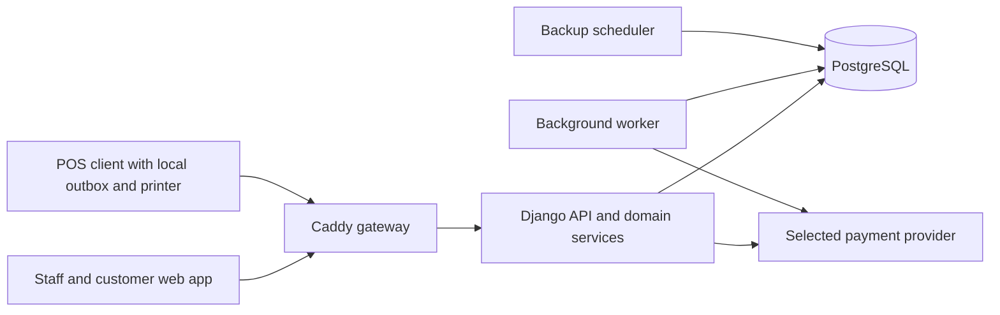

# Proposed architecture for a Nepal parking system

Date: 28 October 2026; client direction accepted 29 October 2026. Status: proposed domain design; the PWA shell is now implemented (see `PWA.md`). Builds on `ARCHITECTURE-COMPARISON.md`. The client target is PWA only, with no Flutter or native Android shell.

## Recommended direction

Keep the existing Django modular monolith, PostgreSQL, Vite React SPA, generated OpenAPI contracts and same-origin browser sessions. Make the system reliable for a cashier at a busy Nepal parking site before adding more customer-facing features.

The largest improvements are open-lot capacity, staff-managed customer records, Nepal calendar and fiscal-period workflows, explicit payment reconciliation, and recoverable offline/POS operation. These are product and data-model changes, not reasons to replace the framework.

## 1. Deployment and ownership

Keep one API deployment and the same application image for its worker. Backups need a schedule and a separate storage destination, not another business application. Production hosting, backup storage and device hardware remain deployment decisions, not assumptions in the domain model.

| Existing module | Proposed responsibility |
|---|---|
| `accounts` | Staff identities, organisation membership, location access, customer profiles, device registration and audit primitives |
| `sites` | Locations, zones, capacity, bays, vehicle classes and versioned tariff terms |
| `parking` | Physical visits, plate matching, reservations and pass entitlements |
| `billing` | Price snapshots, fiscal periods, invoice identity, payments, corrections, cash shifts and receipt history |
| `reports` | Read-only operational and financial projections, with exports using the same filters/totals as the screen |

Put device transport and command ingestion in a small dedicated package when implementing offline work. It must call the existing domain services rather than independently editing parking and billing tables. Do not create a general event bus or another service now.

A printer adapter belongs on the client/device side. Provider verification belongs on the server. Platform administration can remain in Django, with explicit permissions and an audited interface separate from gate operations.

## 2. Change the parking model to fit both open lots and assigned spaces

The current admission path expects a bay. That is suitable for individually managed spaces, but it creates unnecessary work where attendants park many motorcycles in a shared area.

Add a `ParkingZone` under a location. Each zone has one mode: `ASSIGNED_BAY` or `OPEN_CAPACITY`. Start with separate capacity pools per supported vehicle class, rather than a flexible formula for mixed vehicle sizes.

| Record | Proposed change and invariant |
|---|---|
| Zone | Organisation, location, name, operational state and capacity mode |
| Capacity pool | Zone, vehicle class and nonnegative capacity; admission serialises on this row |
| Bay | Belongs to an assigned-bay zone; retains operational state and reservation behaviour |
| Parking session | Always has a location/zone; has a bay only in assigned-bay mode; retains vehicle, entry, tariff and entitlement references |

For online open-lot entry, lock the capacity pool, check active occupancy, and create the session in one transaction. Exit must coordinate with the same pool when it releases capacity. A count followed by an unlocked insert can over-admit vehicles. Bay entry retains its bay lock and database uniqueness guard.

Initially keep reservations on assigned bays. Pooled reservations require a separate interval-capacity design and should not be implied by open-lot support.

Migration: create an assigned-bay zone for each existing location, attach its bays and visits, backfill required references, then tighten constraints. Preserve existing visits and receipt links. Test the complete migration on a copy before applying it to real records.

## 3. Let attendants create customers without forcing online registration

Current `billing/memberships.py::sell_pass()` refuses a member whose email does not match an existing user. That makes a walk-up membership sale depend on the customer first registering online.

Separate an organisation-owned customer profile from an optional online login. Staff can create the member with a name and appropriate contact details; vehicle/pass records attach to that customer. An online identity may be linked later through a verified claim process.

Do not create fake email addresses or default passwords. Do not automatically merge profiles by matching a phone number: families and businesses may share contacts, and phone ownership can change. Verify identity before exposing existing bookings or membership history to a newly linked account.

Keep the existing pass rules: entitlement activates after settlement; renewals preserve the previous terms/history; admitted vehicles cannot exceed the pass limit. Add dedicated sale, lookup, renewal and receipt screens. Treat complimentary or manually extended passes as explicit authorised actions if the target site requires them.

## 4. Add Nepal presentation and fiscal-period concepts without duplicating dates

Store instants in UTC and interpret business dates in the location's time zone. Provide BS input/display conversion through one shared date boundary, with canonical dates used internally. Do not store independent editable AD and BS values for the same date.

Add explicit fiscal periods with a business label, start date, exclusive end date and state. Prevent overlapping active periods within the chosen organisation scope. Historical invoices retain their period and identity after closure.

Keep the current operational receipt distinct from the business invoice identity where necessary. Decide the invoice series scope with the actual operator before implementing counters. Model a series as an explicit identity with its organisation, fiscal period and any required branch/device association, rather than assuming every location or device may issue an independent statutory series.

Invoice snapshots should retain the business/customer details, tax treatment, line totals and numbering context used at issue time. Updating an organisation's address later must not rewrite an old invoice. Existing numbers need an import mapping and must not be renumbered.

This proposal does not assert current Nepal tax requirements or IRD integration rules. Validate the required invoice format, numbering and retention against current requirements before implementing the production billing specification. The old project's `sync_with_IRD` field alone is not evidence of a working integration.

Add fixtures for Kathmandu midnight, overnight stays, BS/AD conversion boundaries, fiscal rollover, Devanagari/provincial plates and the actual site's rate examples. Keep plate display separate from its matching key; do not strip meaningful characters merely to force a match.

## 5. Extend pricing with a small set of proven tariff patterns

Retain integer paisa and immutable tariff versions pinned to visits. Preserve shared Python/TypeScript calculation fixtures. The server determines the amount; the device's calculation is an offline estimate or a recorded offline computation that must be validated under a defined policy.

Start with only the patterns an intended site uses: uniform time blocks, first-hour price followed by smaller increments, and fixed-duration/all-day charging if required. A daily cap is not automatically the same as a calendar-day ticket or overnight policy.

Each tariff must explicitly define grace, rounding, charging boundaries, cap semantics and tax inclusion/exclusion. A new pricing pattern needs new fixtures on both calculators. Avoid arbitrary executable formulas and sprawling JSON configuration.

## 6. Treat payments as evidence, not a selected label

Keep checkout confirmation, payment collection and physical exit as separate operations. Printing must not be required to commit payment or exit; a failed printer should offer a recorded reprint of the same receipt.

| Payment path | Evidence and behaviour |
|---|---|
| Cash | Cashier records collection against an open location shift; append-only ledger entry and receipt commit together |
| Manually recorded QR | Operator records method/reference and attestation; visibly distinct from provider-verified settlement |
| Provider payment | Server records attempt/order identity and validates the provider outcome; browser success screens do not authorise settlement |
| Uncertain result | Retain an unresolved attempt, schedule reconciliation and show it to staff; network timeout is not proof of failure |
| Refund | Explicit request/authorisation, linked to an original capture; cumulative refunds cannot exceed the refundable amount |
| Void | Cancels an eligible obligation with a reason; does not erase captured funds or replace a refund |

Persist a provider attempt before contacting the provider. Make network calls outside database locks, then apply results in a new transaction. Enforce uniqueness on the appropriate provider transaction identity as well as API idempotency keys.

If a callback and a lookup report the same payment, apply one capture. If a late provider payment arrives after cash settlement, preserve the extra money as an unapplied capture and route it to reconciliation/refund; do not attach it as a second settlement or discard it.

Select the actual payment integration from the operator's merchant arrangement. The existing Khalti sandbox roadmap does not establish production support for every QR scheme. Provider-specific APIs and requirements must be checked when implementing the selected adapter.

## 7. Make offline work durable and deliberately limited

Use one locally durable outbox per device. Every command carries a stable operation ID, device sequence, command type, payload version, occurrence time and any required dependency references. The server derives organisation/location authority from the authenticated device; a payload cannot grant itself access.

The device queues a command transactionally with its local state. After a crash, it resends the same command ID. The server stores the payload hash and outcome with the applied transaction, so a lost response does not cause a duplicate visit or collection. Reusing an ID with different content is rejected.

Retain domain event uniqueness beyond short HTTP replay-cache expiry. Preserve rejected/conflicting commands for resolution. Do not delete pending records at midnight, on logout, or after an attempted upload. Device revocation must stop new server writes without silently deleting its local queue.

Initially permit only agreed cash walk-in operations offline. Keep reservations, provider settlement, refunds and new pass entitlement checks online. Persist dependencies so checkout cannot be applied before its offline entry; preserve an entire offline entry/payment/exit journey without pretending a vehicle that has already left is still parked.

**Capacity policy:** multiple disconnected devices cannot guarantee a shared last space. For an initial pilot, use one offline admission device per open-lot capacity pool, or preallocated device capacity quotas if multiple devices are necessary. Define how online admissions respect any outstanding quota. If staff override capacity for physical reasons, record that exception rather than dropping the visit at sync.

Record both device and server times and flag suspicious clock drift. Retain offline tariff version and calculation inputs. Do not silently charge a customer a different amount after reconnecting; discrepancies need a documented reconciliation policy.

If authoritative invoice numbers cannot be safely issued offline, print a clearly identified provisional ticket and resolve it through an approved final-invoice workflow. Do not invent offline tax numbering before the billing policy is settled.

## 8. Use the PWA and prove browser-compatible hardware

Use the installable PWA on supported desktops, tablets and Android devices. Run a proof on the intended browser/printer/scanner: Nepali glyphs, paper width, line wrapping, QR/barcode readability, reprints, paper-out and restart behaviour.

Do not port Flutter or add Capacitor. Use browser print with an OS-supported printer and keyboard-wedge scanners. A vendor SDK-only printer does not become browser-compatible merely by installing the PWA; choose compatible hardware, or separately scope a printer bridge if the operator needs one. Native hardware access is not part of the current delivery.

Track print requests/results as evidence the integration can actually provide. A browser print dialog is not proof that paper was delivered. A reprint keeps its original receipt identity and records its copy number.

## 9. Keep tenant access and failure recovery explicit

Continue organisation scoping before object lookup, aggregation and export; test location restrictions as well as tenant separation. Add database guards to new organisation-owned relationships where practical. Application scoping is still required for reads even when composite foreign keys are present.

Keep browser sessions and CSRF. Use separately revocable device credentials, hashed where suitable, with a registration/rotation process. High-impact actions such as refunds, price overrides and device assignment need server-side permissions and an audit record. A platform administrator's tenant access should be explicit and time-bound where appropriate, not an invisible bypass.

Before real use, add tested backups/restores, structured request logs, worker heartbeat, pending-payment age and pending-device-command indicators. Alert on actionable failures rather than building a large monitoring dashboard first. Use a deployment process that checks configuration, applies compatible migrations, checks readiness and has a recovery path.

Document a total lock order for each new workflow before implementing it. The present pass/bay/session/invoice/shift/counter order must be extended carefully for zone capacity and fiscal counters; a new lock must not be inserted in opposite positions in entry and exit. Add real separate-connection race tests for the affected invariants.

## 10. Implementation order and completion gates

| Stage | Smallest complete delivery | Gate before moving on |
|---|---|---|
| 1. Finish current core | Membership screens, full operational pagination, authoritative occupancy totals, signed-in cash journey | Current PostgreSQL/race tests pass; operator completes an overnight visit and shift close; more than 100 records remain accessible |
| 2. Nepal domain fit | Open-lot zones/capacity, staff-created customer profiles, necessary vehicle classes and tariff patterns | Existing assigned-bay journeys still work; last-space race admits only one vehicle; member can buy a pass without online registration |
| 3. Nepal billing | BS date boundary, fiscal periods, agreed invoice identity and business snapshots | Validated target-site invoice samples; rollover and historical reprint tests; no historical renumbering |
| 4. Financial exceptions | Manual QR distinction, chosen provider adapter if needed, reconciliation, refunds and voids | Duplicate/late/lost-response scenarios preserve correct totals; permissions and audit verified |
| 5. Offline/POS pilot | One chosen hardware path, durable outbox, acknowledgements and staff conflict recovery | Network loss, midnight, restart and response loss preserve data; replay creates one result; chosen printer verified |
| 6. Production cutover | Restore rehearsal, migration/import reconciliation, operational runbook and measured load | Counts, active visits, pass balances and financial totals reconcile; recovery ownership and procedures are established |

Backup/restore fundamentals and configuration hardening must be ready before any stage handles real business records; they are not postponed until the final cutover.

Do not estimate completion dates until the target site's invoice policy, capacity mode, merchant arrangement and POS hardware are known. These are implementation inputs; the first stage can proceed without them.

## Recommended next implementation

Start with stage 1. It completes existing work without committing prematurely to hardware or invoice policy. Then implement zones/capacity and customer-profile independence before offline support, so device sync uses the correct Nepal operating model rather than preserving current assumptions.

The original proposal made no application changes. The subsequent PWA shell implementation and checks are recorded in `PWA.md`. Domain changes, offline transaction sync, hardware and current legal/provider requirements remain unimplemented or unverified as described above.
